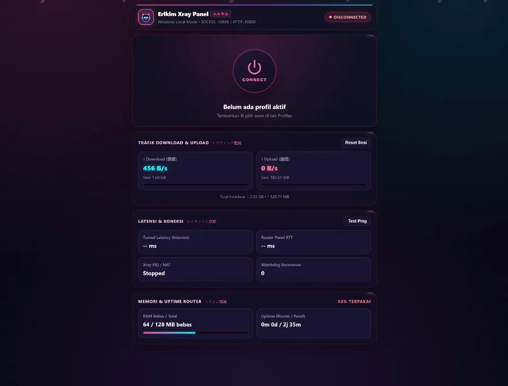
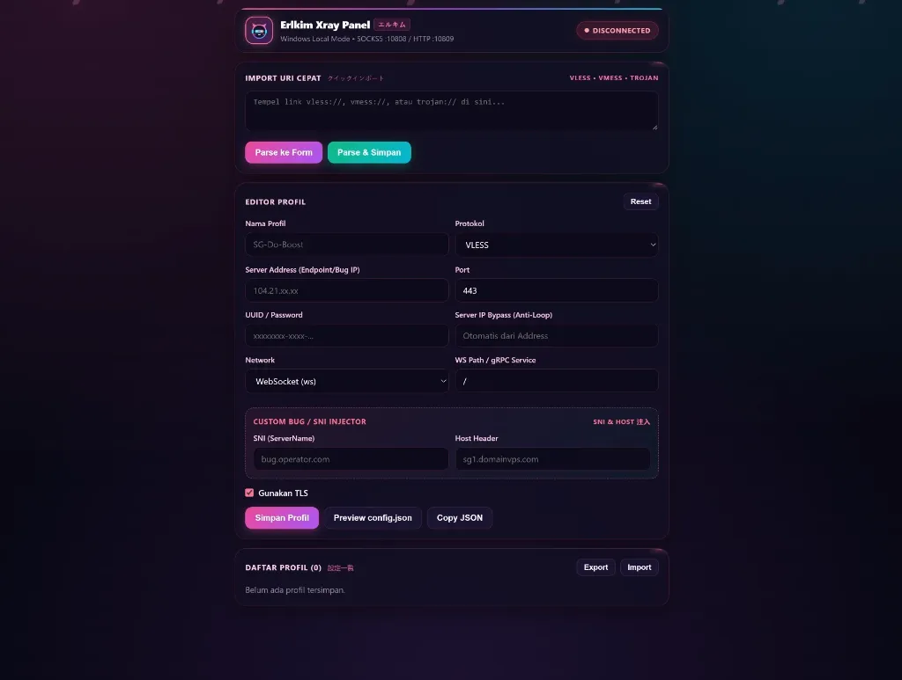
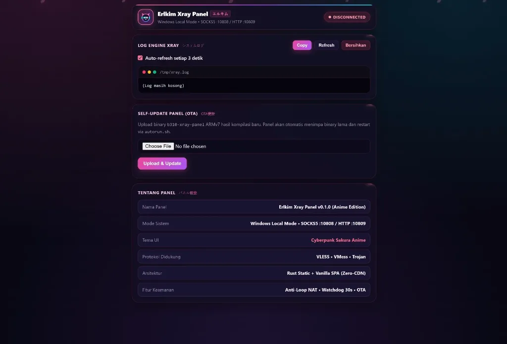

# Erlkim Xray Panel 🌸 (B310-Xray-Panel)

Panel manajemen Xray/V2Ray ultra-ringan (*zero-dependency*) dengan antarmuka **Cyberpunk Sakura Anime Theme** yang dirancang khusus untuk router **Huawei B310s-927** (HiSilicon Balong hi6930 / ARMv7 musl) serta mendukung pengujian lokal di Windows.

---

> [!WARNING]
> ### ⚠️ PERINGATAN PENTING & DISCLAIMER (DWYOR)
> **Segala tindakan modifikasi, flashing firmware kustom, dan injeksi binary ke dalam sistem router dilakukan sepenuhnya atas risiko Anda sendiri (*Do With Your Own Risk*).**
> - **Risiko Kerusakan (Brick / Bootloop):** Kesalahan penulisan partisi, ketidakcocokan versi firmware, atau kegagalan saat proses flashing dapat menyebabkan router mengalami bootloop, stuck lampu indikator, atau semi-brick/mati total.
> - **Kestabilan Daya Listrik:** Pastikan router terhubung ke sumber daya yang stabil (sangat disarankan menggunakan UPS atau adaptor yang tidak longgar) selama proses multicast flashing atau modifikasi partisi.
> - **Wajib Cadangkan Data (Backup NVRAM & IMEI):** Selalu lakukan backup partisi NVRAM, OEMINFO, serta catat IMEI dan serial number router sebelum melakukan flashing firmware baru.
> - **Pembatalan Garansi:** Modifikasi sistem file internal dan flashing firmware non-resmi akan membatalkan seluruh garansi resmi dari pabrikan maupun operator.
> - **Bebas Tanggung Jawab:** Pembuat dan kontributor repositori ini **TIDAK BERTANGGUNG JAWAB** atas segala kerusakan hardware, kehilangan koneksi, hilangnya data, atau kerugian apa pun yang dialami akibat penggunaan proyek atau firmware modifikasi ini.

---

## 📸 Tampilan Antarmuka (Preview)

| 🏠 Home & Monitor Trafik | ⚙️ Profiles & Bug Injector | 📋 Real-time Logs & OTA |
| :---: | :---: | :---: |
|  |  |  |

---

## ✨ Fitur Utama
- **Ultra Ringan & Hemat RAM:** Binary kompilasi statis Rust berukuran hanya **~291 KB (UPX)**, memakan RAM hanya ~2-4 MB (sangat aman untuk RAM 128 MB B310s-927).
- **Native Dokodemo-Door:** Menggunakan fitur redirector bawaan Xray via `iptables` — **TIDAK memerlukan `redsocks` atau `ipt2socks`**.
- **Tema Cyberpunk Sakura Anime:** Tampilan modern, glowing reactor power button, maskot Chibi Cyber Neko SVG, animasi kelopak sakura murni CSS, dan 100% *offline zero-CDN* (tanpa koneksi internet untuk memuat style).
- **Sistem Autentikasi & Ganti Password:** Dilengkapi sistem login aman berbasis token session (30 hari) dan form ganti password langsung dari Web UI (password default: `admin`). Seluruh REST API terlindungi dari akses ilegal.
- **Indikator Trafik & Modem Tools:** Pantau kecepatan Download & Upload real-time, kuota sesi, serta indikator sinyal seluler modem (RSRP, RSRQ, SINR, Band LTE).
- **Quick URI Parser & Bug Injector:** Tempel link `vless://`, `vmess://`, atau `trojan://` langsung terurai otomatis dengan dukungan injeksi Bug SNI dan Host Header.
- **Dual-Mode System:**
  - **Router Linux (Huawei B310s):** Mode transparent proxy redirect port `12345` dan DNS UDP port `12353`.
  - **Windows Local Mode:** Otomatis menghasilkan inbound local SOCKS5 (`127.0.0.1:10808`) dan HTTP (`127.0.0.1:10809`) untuk pengujian langsung di PC.
- **Anti-Loop VPS & Watchdog 30s:** Mencegah perutean melingkar ke IP server VPS dan memulihkan proses Xray secara otomatis jika mendadak mati.
- **OTA Self-Update:** Update binary panel langsung dari Web UI tanpa perlu bongkar router lagi.

---

## 🔐 Keamanan & Akses Default
Saat pertama kali membuka panel, Anda akan diarahkan ke layar login:
- **Alamat Akses:** `http://192.168.8.1:5000` (atau via menu `🌸 XRAY` di WebUI router jika menggunakan firmware mod).
- **Password Default:** `admin`
- **Cara Mengganti Password:**
  1. Masuk ke panel dengan password default.
  2. Buka tab **Logs & Sys**.
  3. Gulir ke bagian **Keamanan Panel (Ganti Password)**.
  4. Masukkan password lama (`admin`) dan ketikkan password baru Anda.
  5. Password baru akan di-hash secara aman dan disimpan pada file `auth.json`. Sesi login berlaku selama 30 hari.

---

## 📁 Struktur Direktori
- `src/main.rs` — Backend HTTP (`tiny_http`), process manager (`xray`), watchdog thread, network traffic reader, dan REST API.
- `web/index.html` — Frontend SPA tunggal yang di-embed langsung ke dalam binary (`include_str!`).
- `scripts/net.sh` — Manajemen aturan `iptables` NAT PREROUTING dan anti-loop bypass IP VPS.
- `dist/` — Pre-compiled binary deployment untuk router ARMv7:
  - `dist/b310-xray-panel` (Binary panel Rust ARMv7 musl terkompresi UPX)
  - `dist/xray` (Xray-core v26.11.9 ARMv7 terkompresi UPX)
  - `dist/net.sh` (Skrip iptables)
- `.cargo/config.toml` — Konfigurasi target `armv7-unknown-linux-musleabihf` menggunakan `rust-lld` dan tuning hardware Balong (`+vfp3d16,-d32,-neon`).
- `assets/` — Gambar preview screenshot antarmuka tema Anime.

---

## 🛠️ Cara Kompilasi

### 1. Build untuk Windows (Pengujian Lokal)
```powershell
cargo build --release
# Jalankan panel:
.\target\release\b310-xray-panel.exe
# Buka http://localhost:5000 di browser
```

### 2. Cross-Compile untuk Huawei B310s-927 (ARMv7)
1. Pasang target ARMv7 musl di Rust:
   ```powershell
   rustup target add armv7-unknown-linux-musleabihf
   ```
2. Jalankan kompilasi release:
   ```powershell
   cargo build --release --target armv7-unknown-linux-musleabihf
   ```
3. Kompres dengan UPX (opsional untuk memperkecil ukuran dari ~680 KB ke ~290 KB):
   ```powershell
   upx --best --lzma target/armv7-unknown-linux-musleabihf/release/b310-xray-panel
   ```

---

## 🚀 Panduan Deployment ke Router B310s-927

Terdapat dua metode pemasangan yang dapat dipilih:

### Metode 1: Flashing Firmware Modifikasi .BIN (Rekomendasi - Permanen & Terintegrasi WebUI)

> [!NOTE]
> File firmware binary (`.BIN`) hasil modifikasi tidak diunggah ke repositori publik ini karena batasan ukuran berkas dan lisensi proprietary vendor. **Bagi yang berminat atau membutuhkan file firmware `.BIN` siap pakai ini, silakan hubungi saya melalui [GitHub Issues](https://github.com/erlk1m/B310-Xray-Panel/issues) atau kontak profil GitHub [@erlk1m](https://github.com/erlk1m).**

Bagi yang sudah memiliki file firmware hasil injeksi:
1. Pastikan router dalam mode USB Flashing / Multicast Upgrade (menggunakan *Huawei Multicast Upgrade Tool* atau *balong_flash*).
2. Lakukan flashing file `.BIN` modifikasi ke router.
3. Setelah proses selesai dan router restart:
   - Panel Xray otomatis berjalan di latar belakang via `/system/bin/b310-xray-panel`.
   - Buka WebUI router di `http://192.168.8.1`, menu tab baru **🌸 XRAY** akan langsung tersedia di bilah navigasi atas (atau akses mandiri di port `5000`).

---

### Metode 2: Manual via Telnet ke Partisi `/online` (Tanpa Flash Ulang)

#### 1. Transfer File ke Router
Siapkan file dari folder `dist/` (`b310-xray-panel`, `xray`, dan `net.sh`), lalu bagikan lewat HTTP server sederhana di PC:
```powershell
python -m http.server 8000
```

Buka sesi **Telnet** ke router (`telnet 192.168.8.1`), lalu unduh file ke partisi `/online`:
```sh
mkdir -p /online/xray && cd /online/xray
wget http://<IP_PC>:8000/b310-xray-panel
wget http://<IP_PC>:8000/xray
wget http://<IP_PC>:8000/net.sh
chmod +x b310-xray-panel xray net.sh
```

#### 2. Pasang Auto-Start di `autorun.sh`
Tambahkan pemanggilan background daemon ke `/system/etc/autorun.sh` agar panel otomatis aktif setiap router dinyalakan:
```sh
(
  while true; do
    cd /online/xray && ./b310-xray-panel >/dev/null 2>&1
    sleep 2
  done
) &
```

#### 3. Akses Panel
Buka browser dan akses alamat IP router Anda:
```
http://192.168.8.1:5000
```

---

## 📜 Lisensi
MIT License - Dibuat untuk komunitas oprek router Huawei B310s.
